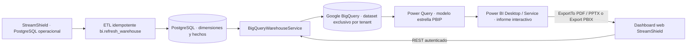

# Analítica StreamShield en Google Cloud y Power BI

Esta integración toma datos operacionales de StreamShield, mantiene un Data Warehouse dimensional en PostgreSQL y replica sus dimensiones y hechos a **BigQuery** en Google Cloud. Power BI Desktop/Service conecta directamente a BigQuery. Cada tenant se escribe en un dataset independiente; la API vuelve a generar esas tablas desde el almacén real y no crea filas de demostración.

## Arquitectura que ejecuta el código

El backend y el cron existentes consultan PostgreSQL. `bi.refresh_warehouse` carga el esquema estrella; después `BigQueryWarehouseService` reemplaza las tablas correspondientes en `streamshield_bi_<tenant_uuid_sin_guiones>`. El usuario puede iniciar la sincronización desde **Power BI SOC Analytics → Sync BigQuery**, y el cron `anti-bots-bi-refresh` la realiza diariamente tras la carga SQL. La API usa Google Application Default Credentials y nunca acepta un `tenant_id` del navegador para seleccionar el destino.

## Orígenes y modelo dimensional

Las fuentes operacionales son las tablas PostgreSQL `streams`, `viewer_sessions`, `attacks`, `stream_events` y `users`, junto con las agregaciones de chat disponibles. La transformación se encuentra en `sql/002_refresh_warehouse.sql`; el backend ejecuta el procedimiento después de las migraciones del warehouse.

Cada dataset tenant-scoped de BigQuery contiene:

| Tabla BigQuery | Tipo | Grano |
| --- | --- | --- |
| `dim_date` | Dimensión | Una fila por fecha del calendario. |
| `dim_platform` | Dimensión | Una fila por plataforma. |
| `dim_stream` | Dimensión | Una fila por canal del tenant. |
| `dim_streamer` | Dimensión | Una fila por propietario/streamer del tenant. |
| `vw_powerbi_stream_snapshot` | Hecho | Canal y día: viewers, chatters, amenazas, engagement y riesgo. |
| `vw_powerbi_viewer_session` | Hecho | Una fila por sesión de espectador. |
| `vw_powerbi_attack` | Hecho | Una fila por ataque/incidente. |
| `vw_powerbi_chat_activity` | Hecho | Canal, día y tipo de evento de chat. |

Las relaciones del modelo Power BI son `dim_stream[stream_id]` a cada hecho por `stream_id`, `dim_date[full_date]` a la fecha del hecho y `dim_platform[platform_key]` a `dim_stream[platform_key]`. Están declaradas en `powerbi/StreamShield-BI.SemanticModel/definition/relationships.tmdl`. El PBIP incluye medidas DAX y dos páginas con KPIs, tendencias, severidad, segmentadores y detalle de canales.

## Preparar el proyecto Google Cloud

Se requiere un proyecto Google Cloud existente con facturación habilitada. El código crea datasets y tablas, pero no activa facturación ni aprovisiona recursos en una cuenta sin autorización del propietario.

1. Instala Terraform 1.6+, Google Cloud CLI y habilita `bigquery.googleapis.com` en el proyecto. Autentica la cuenta administradora para aplicar Terraform.
2. Desde `business-intelligence/terraform-gcp`, copia `terraform.tfvars.example` a `terraform.tfvars` y asigna el `project_id` real. Ese archivo está ignorado por Git.
3. Ejecuta `terraform init`, `terraform validate`, `terraform plan` y revisa el plan antes de aplicar. `terraform apply` habilita la API y crea `streamshield-bi-sync` con `roles/bigquery.user`; ese rol permite crear datasets y jobs, y el creador obtiene propiedad sobre los datasets que crea.
4. Configura `GOOGLE_CLOUD_PROJECT_ID`, `BIGQUERY_ENABLED=true`, `BIGQUERY_LOCATION` y `BIGQUERY_DATASET_PREFIX` en el backend y en el cron. La región del dataset de BigQuery debe coincidir con la elegida en Power BI.
5. Para desarrollo local, configura ADC con `gcloud auth application-default login`. En producción en Google Cloud, asigna la service account al runtime. En un host externo como Render, usa Workload Identity Federation si el host lo permite; de lo contrario, monta una credencial de service account como secreto y define `GOOGLE_APPLICATION_CREDENTIALS` con su ruta. No guardes llaves JSON en el repositorio ni en el PBIP.
6. Ejecuta `sql/001_warehouse.sql` y `sql/002_refresh_warehouse.sql` en la base operacional, despliega API/worker y cron, y autentícate en la aplicación con un usuario analista. La sincronización manual está en `POST /api/v1/analytics/bigquery/sync`; `GET /api/v1/analytics/bigquery/config` devuelve el proyecto y dataset autorizados para la sesión.

Terraform crea el principal, no crea la cuenta de servicio en la plataforma de alojamiento ni publica el informe en Microsoft. La cuenta Microsoft/Power BI y el proyecto GCP son recursos del equipo.

## Conectar el modelo interactivo de Power BI

1. Abre `powerbi/StreamShield-BI.pbip` en Power BI Desktop actualizado. Las consultas M usan el conector oficial `GoogleBigQuery.Database` y las expresiones `pBillingProjectId`, `pProjectId` y `pDataset`.
2. En los parámetros del modelo, pon el ID de proyecto con permisos para ejecutar BigQuery jobs, el proyecto que contiene el dataset y el nombre devuelto por `GET /api/v1/analytics/bigquery/config`. El dashboard web también muestra el destino cuando la integración está configurada.
3. En el diálogo de credenciales del conector BigQuery, inicia sesión con el Google principal asignado a ese tenant. Dale `BigQuery Data Viewer` solamente sobre ese dataset y `BigQuery Job User` en el proyecto de facturación/ejecución; no compartas datasets de otros tenants.
4. Actualiza el modelo en Desktop, valida las ocho tablas y las relaciones, y publica en un workspace privado de Power BI. En Service crea la conexión cloud de Google BigQuery con el principal autorizado, configura credenciales y programa el refresh después del cron (el cron actual corre a las 07:00 UTC).
5. El informe incluye **Resumen ejecutivo** y **Actividad y riesgo**. Los segmentadores de fecha, plataforma, canal y riesgo/severidad filtran los visuales relacionados. Se pueden incorporar páginas desde el proyecto PBIP manteniendo el mismo modelo.

La integración BigQuery–Power BI es cloud-to-cloud y no necesita gateway PostgreSQL. El conector admite inicio de sesión organizacional o service account. La actualización en Desktop/Service requiere credenciales de Google válidas y permisos IAM del principal.

## Descargar informes publicados desde la aplicación

La sección de exportaciones del dashboard ofrece dos flujos distintos:

- **JSON, Excel y paquete Power BI:** los genera StreamShield a partir de la analítica filtrada por el tenant autenticado.
- **Power BI PDF, PowerPoint y PBIX:** solicita el informe publicado a Power BI REST API y descarga los bytes reales del servicio; no fabrica una vista ni convierte un paquete ZIP en un informe.

Para el segundo flujo, configura `POWERBI_ENABLED=true`, `POWERBI_TENANT_ID`, `POWERBI_CLIENT_ID`, `POWERBI_CLIENT_SECRET`, `POWERBI_GROUP_ID`, `POWERBI_REPORT_ID` y `POWERBI_REPORT_TENANT_ID`. La ruta solo permite exportar el informe al tenant configurado y responde 404 a los demás. El service principal debe estar habilitado en el tenant de Power BI, autorizado para usar las APIs y miembro del workspace. La descarga PDF/PPTX usa el endpoint asíncrono de exportación; Microsoft exige capacidad Fabric/Premium/Embedded compatible y no admite esa API para PPU. La descarga PBIX usa el endpoint de exportación de informe y está sujeta a las limitaciones del modelo publicado. Un informe exportable debe existir ya en el workspace; el código no afirma que haya publicado uno automáticamente.

La aplicación envía `GET /api/v1/analytics/exports/powerbi-report?format=pdf|pptx|pbix` con el JWT del usuario. El backend valida tenant, obtiene el token de Microsoft en servidor, exporta el ID de informe configurado y devuelve el archivo como adjunto. Los secretos no pasan al navegador.

## Variables de entorno

| Variable | Uso |
| --- | --- |
| `BIGQUERY_ENABLED` | Habilita el mirror/ETL. |
| `GOOGLE_CLOUD_PROJECT_ID` | Proyecto BigQuery de destino. |
| `BIGQUERY_LOCATION` | Región/multirregión BigQuery. |
| `BIGQUERY_DATASET_PREFIX` | Prefijo del dataset tenant. |
| `GOOGLE_APPLICATION_CREDENTIALS` | Ruta a credencial montada como secreto, si no se usa ADC del runtime. |
| `POWERBI_ENABLED` y credenciales `POWERBI_*` | Sincronización del push dataset existente. |
| `POWERBI_REPORT_ID`, `POWERBI_REPORT_TENANT_ID` | Informe publicado y tenant autorizado para sus descargas. |
| `POWERBI_EXPORT_TIMEOUT_SECONDS` | Tiempo máximo de espera para exportación PDF/PPTX. |

## Evidencia reproducible y estado externo

1. En StreamShield inicia sesión y ejecuta **Sync BigQuery**. La respuesta incluye proyecto, dataset tenant y filas cargadas por tabla.
2. En Google Cloud Console abre BigQuery y comprueba las ocho tablas bajo el dataset cuyo sufijo corresponde al tenant autenticado. Su contenido se obtiene de la consulta PostgreSQL de ese tenant.
3. Conecta el PBIP con las credenciales Google autorizadas, actualiza el modelo y captura las páginas y filtros en Desktop/Service.
4. Desde la aplicación descarga PDF/PPTX/PBIX del informe publicado y conserva la respuesta de API o captura de descarga como evidencia.

Este repositorio no contiene credenciales del proyecto GCP ni de Power BI Service; por eso no puede aprovisionar recursos, cargar datos a una cuenta real, publicar el informe ni adjuntar una captura con datos reales. Los flujos, rutas y artefactos están implementados y esperan esas credenciales y el informe publicado del equipo. No se usan datos sintéticos.

## Infraestructura AWS preexistente

`terraform/` conserva el diseño alternativo previo con Amazon RDS. No es necesario para el destino BigQuery; el proveedor vigente para este flujo es `terraform-gcp/`. Los scripts `scripts/validate_warehouse.py` y el esquema `sql/` siguen sirviendo para validar la capa PostgreSQL común antes de reflejarla en BigQuery.
