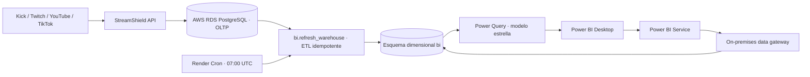

# Proyecto aplicado de Business Intelligence — StreamShield

Esta carpeta implementa el almacén dimensional, la carga ETL, las transformaciones Power Query y los materiales del modelo Power BI para datos operacionales reales de StreamShield. No contiene filas inventadas ni credenciales.

## Arquitectura elegida

- **Nube:** AWS.
- **Base de datos:** Amazon RDS for PostgreSQL. Terraform crea la instancia cifrada y con backups; los CIDR autorizados limitan el acceso al origen fijo del backend, la puerta de enlace Power BI y la estación administradora.
- **OLTP:** tablas PostgreSQL existentes de StreamShield (`streams`, `viewer_sessions`, `attacks`, `stream_events`, `users`).
- **ETL:** procedimiento PostgreSQL tenant scoped que realiza upsert en el esquema `bi`; la clave natural evita duplicados y el agregado de chat se reconstruye por ventana.
- **Data Warehouse:** dimensiones conformadas de fecha, plataforma, canal y streamer; hechos de snapshots diarios, sesiones, ataques y actividad de chat.
- **Power BI:** importación de vistas tenant scoped con PostgreSQL. El gateway de datos de Power BI en un host con IP de salida fija permite que Power BI Service actualice RDS sin abrir PostgreSQL a Internet.
- **Automatización:** Render Cron ejecuta ETL todos los días a las 07:00 UTC. Configura en Power BI Service la actualización diaria a las 08:00 UTC para leer la carga ya terminada.



AWS publica PostgreSQL 16.15 para RDS a la fecha de esta implementación; confirma la disponibilidad de la versión y de la clase de instancia en la región elegida antes de aplicar Terraform ([versiones RDS PostgreSQL](https://docs.aws.amazon.com/AmazonRDS/latest/PostgreSQLReleaseNotes/postgresql-versions.html)).

## Archivos

- `terraform/`: instancia RDS, cifrado, backups, protección contra borrado y firewall por allowlist.
- `sql/001_warehouse.sql`: dimensiones, hechos, vistas filtradas por identidad de base de datos e índices.
- `sql/002_refresh_warehouse.sql`: procedimiento idempotente `bi.refresh_warehouse(tenant_uuid, from_date)`.
- `sql/003_powerbi_tenant_role.sql`: aprovisionamiento de un login Power BI de solo lectura para un tenant.
- `sql/004_application_role.sql`: login de servicio para API/ETL, separado de la cuenta maestra RDS.
- `scripts/refresh_warehouse.py`: entrada local de la carga diaria idempotente; comparte la implementación con `backend/app/services/analytics/warehouse_refresh.py`.
- `scripts/validate_warehouse.py`: compara dimensiones y hechos con las tablas operacionales por tenant; sale con código distinto de cero ante diferencias.
- `powerbi/PowerQuery.m`: diez pasos de transformación, sin credenciales incluidas.
- `powerbi/queries/`: consultas M completas para dimensiones y hechos tenant scoped; `PowerQuery.m` transforma el snapshot para análisis.
- `powerbi/measures.dax`: medidas KPI para el modelo estrella.
- `powerbi/StreamShield-BI.pbip`: proyecto inicial de Power BI con modelo TMDL y reporte PBIR de dos páginas; requiere completar conexión/credenciales y validarlo en Power BI Desktop.

## Implementación de infraestructura

1. Instala Terraform 1.6+ y AWS CLI; configura un perfil AWS con permisos acotados para RDS, VPC, grupos de seguridad e IAM DB authentication. Usa una cuenta no productiva primero.
2. En `business-intelligence/terraform`, copia `terraform.tfvars.example` a `terraform.tfvars`; reemplaza el CIDR de ejemplo por las IPs estáticas `/32` del backend/gateway y del administrador. No uses `0.0.0.0/0`.
3. RDS genera y guarda la contraseña maestra en AWS Secrets Manager. El estado Terraform local contiene metadatos del recurso; para equipos usa un backend remoto S3 cifrado y bloqueo de estado. No subas el estado ni `terraform.tfvars` a Git.
4. Ejecuta `terraform init`, `terraform fmt -check`, `terraform validate`, `terraform plan` y revisa el plan; luego aplica con `terraform apply` en la cuenta autorizada. Recupera la contraseña desde el ARN `master_user_secret_arn` sólo para la migración/bootstrap; la aplicación debe usar un login de servicio de privilegio mínimo.
5. Guarda endpoint y credenciales de servicio en el gestor de secretos. Después de ejecutar `001` y `002`, crea el usuario `streamshield_app` con `004_application_role.sql`; configura `DATABASE_URL` con ese usuario y el formato PostgreSQL que usa el backend (`postgresql+asyncpg://...`) con TLS (`sslmode=require`) y despliega la API hacia RDS. El rol se separa de la cuenta maestra, aunque conserva permisos DDL porque la API actual ejecuta migraciones al iniciar. Si la API sigue en Render, autoriza únicamente su egress IP estática; sin egress fijo usa el backend de [VPS](../deploy/vps/README.md) y permite la IP pública fija de ese host.

Antes de cambiar producción, exporta la base PostgreSQL fuente con `pg_dump --format=custom --no-owner --no-acl` y restáurala en RDS con `pg_restore --no-owner --no-acl`. Haz la transferencia en una ventana de mantenimiento: detén escrituras, conserva el backup fuera del repositorio en almacenamiento cifrado, restaura, compara conteos de `tenants`, `users`, `streams`, `viewer_sessions`, `attacks` y `stream_events`, y sólo entonces cambia `DATABASE_URL` en API/worker. Las credenciales se suministran desde el gestor de secretos; no se escriben como argumentos visibles ni se adjunta un dump al proyecto.

La infraestructura no se ha creado en una cuenta AWS desde este entorno: no hay credenciales de cuenta ni autorización de acceso disponibles. La plantilla está lista para revisión y aplicación en la cuenta propietaria.

## Carga del esquema y ETL

Tras restaurar la base fuente, ejecuta la inicialización PostgreSQL como administrador, luego termina las migraciones operacionales y ejecuta el DDL/ETL del warehouse:

```powershell
psql "$env:BI_DATABASE_URL" -v ON_ERROR_STOP=1 -f infrastructure/postgres/init.sql
psql "$env:BI_DATABASE_URL" -v ON_ERROR_STOP=1 -f business-intelligence/sql/001_warehouse.sql
psql "$env:BI_DATABASE_URL" -v ON_ERROR_STOP=1 -f business-intelligence/sql/002_refresh_warehouse.sql
psql "$env:BI_DATABASE_URL" -v ON_ERROR_STOP=1 -f business-intelligence/sql/004_application_role.sql
```

El job `anti-bots-bi-refresh` está declarado en `render.yaml`; su imagen usa `backend/` como raíz y ejecuta `python scripts/refresh_warehouse.py`, que comparte el módulo `app.services.analytics.warehouse_refresh` con la entrada local. Al enlazarlo en Render, define `DATABASE_URL` igual al backend. El job sólo actualiza el warehouse y no necesita credenciales de Power BI. Power BI Service consulta ese warehouse mediante el gateway en su horario de refresh. La ruta opcional `/api/v1/analytics/powerbi/sync` conserva el modo push y requiere credenciales de Service Principal; el Service Principal debe estar permitido en la configuración del tenant de Power BI, tener permiso de escritura en el workspace y usar el scope `Dataset.ReadWrite.All`.

Prueba manual, una vez desplegado y con streams reales:

```sql
CALL bi.refresh_warehouse('UUID-REAL-DEL-TENANT'::uuid, current_date - 90);
SELECT count(*) FROM bi.dim_stream;
SELECT snapshot_date, count(*) FROM bi.fact_stream_snapshot GROUP BY snapshot_date ORDER BY snapshot_date DESC;
SELECT count(*) FROM bi.fact_viewer_session;
SELECT count(*) FROM bi.fact_attack;
SELECT count(*) FROM bi.fact_chat_activity;
```

Las consultas de conteo deben ejecutarse como administrador para inspeccionar todo el warehouse. El job registra resultado/errores en los logs de Render. No se declaran resultados de ejecución hasta correrlos contra la base real.

Para validar contra una base real después de cargar el warehouse, configura `DATABASE_URL` en el entorno sin pegar credenciales en el repositorio y ejecuta desde la raíz del proyecto:

```powershell
python business-intelligence/scripts/validate_warehouse.py
```

El validador comprueba que `dim_date` sea un calendario continuo de años completos y compara, por tenant, canales, sesiones, ataques, cantidad y valores del snapshot diario, y mensajes/grupos de actividad de chat de los últimos 90 días. Imprime las cuentas y discrepancias y termina con código 1 si detecta diferencias. Sólo usa filas existentes; no genera datos sintéticos. Aún no se ha ejecutado contra datos de RDS porque no hay una conexión a la base desplegada.

## Seguridad y conexión de Power BI

1. Crea un usuario PostgreSQL por tenant ejecutando `sql/003_powerbi_tenant_role.sql` como administrador. Sustituye el nombre, contraseña aleatoria, UUID del tenant y base de datos. No reutilices el usuario propietario.
2. El login sólo recibe `SELECT` sobre vistas y dimensiones aprobadas. Las vistas comprueban `session_user` contra `bi.user_tenant_access`; la identidad no mapeada no devuelve filas. No concedas acceso directo a las tablas `fact_*`, `dim_stream` o `dim_streamer`.
3. En Power BI Desktop, instala el conector PostgreSQL actualizado, selecciona **Obtener datos → PostgreSQL**, usa endpoint RDS, puerto 5432, base `streamshield` y modo **Importar**. Autentica con el login exclusivo del tenant.
4. Importa y renombra las vistas a `dim_date`, `dim_platform`, `dim_stream`, `dim_streamer`, `fact_stream_snapshot`, `fact_viewer_session`, `fact_attack`, `fact_chat_activity`. Usa las vistas `vw_powerbi_*` correspondientes y las tablas de fecha/plataforma compartidas.
5. En Power Query crea parámetros de texto `pServer` y `pDatabase`. Crea una consulta por cada archivo de `powerbi/queries/` y nómbralas según su archivo; usa `powerbi/PowerQuery.m` como consulta `fact_stream_snapshot`. Los diez pasos de esta última: (1) seleccionar columnas analíticas reduce datos cargados; (2) limpiar/recortar canal y plataforma normaliza texto; (3) reemplazar conteos nulos por cero estabiliza agregados; (4) asignar tipos evita comparaciones incorrectas; (5) descartar claves/fechas inválidas protege relaciones; (6) quitar duplicados por canal-fecha garantiza el grano del snapshot; (7) combinar plataforma integra la dimensión; (8) expandir el nombre normalizado evita códigos crudos en visuales; (9) calcular cobertura chat/viewers crea un KPI comparable; (10) clasificar amenaza en bandas y crear mes de inicio habilita segmentación temporal. Las dos últimas columnas son derivadas, no sustituyen los datos fuente.
6. Relaciona `dim_stream[stream_id]` con cada hecho por `stream_id` (1 a muchos); `dim_date[full_date]` con la fecha correspondiente de cada hecho; `dim_platform[platform_key]` con `dim_stream[platform_key]`. Marca `dim_date` como tabla de fechas.
7. Crea las medidas de `powerbi/measures.dax`. Los KPI de streams, viewers y chatters en vivo usan el ultimo snapshot disponible dentro del filtro de fecha para no sumar el historico diario. Tablero sugerido: **Resumen ejecutivo** (streams live, viewers, chatters, riesgo, ataques activos); **Actividad** (línea de mensajes por fecha, cobertura por canal y plataforma); **Amenazas** (ataques por severidad/tipo, viewers sospechosos, tabla de mitigaciones); **Sesiones** (duración, mensajes y riesgo por canal). Añade segmentadores de fecha, plataforma, canal y severidad.
8. Publica en un workspace dedicado. Instala y registra el **On-premises data gateway** en el host con IP autorizada, registra la conexión PostgreSQL con las credenciales del tenant y enlázala al semantic model. En Power BI Service activa actualización diaria a las 08:00 UTC. La cuenta/licencia, el workspace y el gateway son recursos del usuario y deben habilitarse en Microsoft 365.

El PBIP es un proyecto fuente editable con ocho tablas TMDL, relaciones, medidas y dos páginas PBIR. Abre `powerbi/StreamShield-BI.pbip` en Power BI Desktop, configura `pServer` y `pDatabase`, y proporciona las credenciales PostgreSQL del tenant en el diálogo de conexión; no guardes credenciales en el proyecto. Revisa que las vistas `vw_powerbi_*` existan, valida que todas las tablas y visuales carguen, y marca `dim_date[full_date]` como tabla de fechas tras verificar valores únicos, continuidad y años completos. El ETL crea el calendario desde el 1 de enero del año inicial de los datos hasta el 31 de diciembre del año actual. Las consultas M completas están en `powerbi/queries/`; `powerbi/PowerQuery.m` define diez transformaciones del snapshot. Compara las medidas con conteos SQL antes de publicar.

Este entorno no tiene Power BI Desktop, RDS ni una cuenta Power BI Service, así que el PBIP no se ha abierto ni validado contra datos reales. La carga del modelo, la exportación final a PBIX, y la publicación requieren Desktop/Service y cuentas autorizadas; no se afirma que esas acciones externas se hayan ejecutado.

## Exportación y actualización mediante API

La API ofrece CSV/JSON/Excel y paquete Power BI bajo `/api/v1/analytics/exports/*`, requiere usuario analista y filtra por tenant. El endpoint opcional `/api/v1/analytics/powerbi/sync` crea un push dataset cuyo nombre lleva un sufijo del tenant. Cada ejecución borra las filas anteriores de cada tabla push y carga la instantánea actual; Microsoft documenta esta operación para push datasets ([Delete Rows](https://learn.microsoft.com/en-us/rest/api/power-bi/push-datasets/datasets-delete-rows-in-group)). El proyecto principal usa PostgreSQL Import + gateway porque el push API tiene límites de almacenamiento y lote documentados por Microsoft ([limitaciones de push](https://learn.microsoft.com/en-us/power-bi/developer/embedded/push-datasets-limitations)). Mantén el workspace privado para el equipo autorizado; el sufijo del dataset no sustituye permisos/RLS de Power BI.

## Evidencias y límites de esta entrega

- Verificación local: PostgreSQL temporal ejecutó `001_warehouse.sql`, creó el procedimiento de `002_refresh_warehouse.sql` y lo llamó contra un esquema operacional vacío, modelado con las columnas requeridas. El calendario resultante fue continuo y cubrió 2026 completo (365 días); no se insertaron filas de negocio. Esto valida sintaxis/ejecución del DDL y del camino vacío, pero no valida conteos ni resultados con datos reales.
- El DDL/ETL y los conectores se construyen a partir del esquema operacional existente; no se insertan registros sintéticos.
- La evidencia de conteos, conexión Power BI, publicación y refresh debe capturarse después de aplicar la infraestructura y ejecutar el proyecto contra una cuenta AWS y tenant Microsoft reales.
- El archivo adjunto registra 401 en rutas protegidas servidas tanto por el dominio directo de Render como por el rewrite de Vercel. No incluye el cuerpo de respuesta, encabezado Authorization ni cookies; por eso no demuestra que ambas llamadas usaran el mismo token ni identifica la causa. El cliente intenta renovar el access token usando la cookie HttpOnly y reintenta la llamada una sola vez. Diagnostico pendiente en las cuentas: iniciar sesion de nuevo, comprobar `/api/v1/auth/me` con ese access token y confirmar en Render que todas las instancias usan el mismo `JWT_SECRET_KEY`; no copiar tokens, cookies ni secretos en tickets o logs. Si `/auth/me` devuelve 200 pero una ruta protegida sigue en 401, revisar los logs del mismo despliegue y confirmar que Vercel y las llamadas directas apuntan al API esperado.

## Trazabilidad de requisitos

| Requisito | Implementación |
|---|---|
| Nube, PostgreSQL y seguridad | `terraform/`, `sql/003_powerbi_tenant_role.sql` |
| Modelo relacional | tablas operacionales existentes y `sql/001_warehouse.sql` |
| Inserción y consistencia | upsert desde datos operacionales en `sql/002_refresh_warehouse.sql` |
| Conexión/importación Power BI | guía de conexión de esta página y vistas tenant scoped |
| 8+ transformaciones Power Query | `powerbi/PowerQuery.m` |
| Data Warehouse y ETL | esquemas `bi` y procedimiento idempotente |
| KPI/tablero | `powerbi/measures.dax`, `powerbi/StreamShield-BI.pbip` y páginas PBIR incluidas |
| Publicación | procedimiento de workspace/gateway arriba; requiere sesión Microsoft |
| Código y documentación | esta carpeta y `project-docs/POWERBI-ANALYTICS.md` |
| Actualización automática | cron diario + Power BI Service refresh; requiere activar credenciales y gateway |
