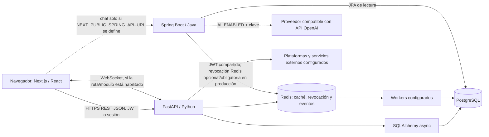
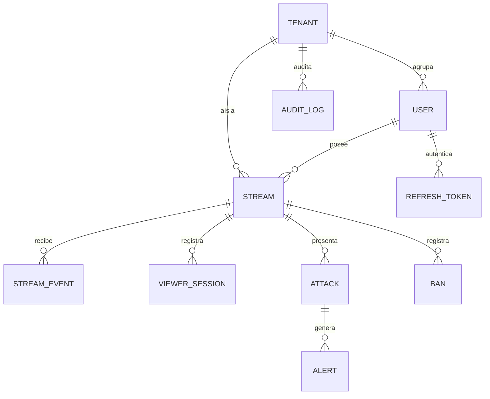

# Documento técnico — Desarrollo Web Avanzado

**Proyecto:** StreamShield (repositorio `Anti-Bots`)  
**Repositorio:** [github.com/NlsG09201/Anti-Bots](https://github.com/NlsG09201/Anti-Bots)  
**Estado descrito:** implementación presente en el repositorio al 20 de noviembre de 2026.

Este documento describe la aplicación comprobable en el código. La API operativa completa es FastAPI. `backend-spring/` es un servicio Java real, independiente y complementario, con el asistente SOC y lectura de canales; no reemplaza todavía los módulos de FastAPI. Las integraciones de terceros requieren sus propias cuentas, permisos y secretos.

## 1. Stack y ambiente tecnológico

| Componente | Tecnología y versión relevante | Uso |
| --- | --- | --- |
| Interfaz web | TypeScript, React 19, Next.js 16.4.3, Tailwind CSS 3 | Aplicación web, rutas de dashboard y visualizaciones. |
| API principal | Python 3.11, FastAPI 0.161.1, Uvicorn 0.34.0, Pydantic 2.10.6 | API REST, autenticación, reglas de dominio, webhooks y WebSockets. |
| Persistencia principal | PostgreSQL; SQLAlchemy 2.0.36, asyncpg 0.30.0 y Alembic 1.14.0 | Datos operacionales y consultas asíncronas. |
| Eventos y caché | Redis 5.2.1, arq 0.26.1 | Caché, revocación de tokens y procesamiento/eventos cuando se configura Redis TCP. |
| Servicio Java complementario | Java 21, Spring Boot 4.1.2, Spring AI 2.0.2, Spring Security y Spring Data JPA | Rutas del asistente SOC y consulta de canales aislada por tenant. |
| Analítica/ML | scikit-learn 1.5.0, Weka J48 (python-weka-wrapper3 0.3.3); Power BI y BigQuery opcionales | Clasificación/analítica según módulos y configuración. |
| Pruebas y construcción | Maven en Java; npm, ESLint y TypeScript en frontend; pytest en backend | Construcción y validaciones automatizadas definidas por el proyecto. |

La lista Python completa está en [`backend/requirements.txt`](../backend/requirements.txt) y sus dependencias de desarrollo en `backend/requirements-dev.txt`. Las dependencias Java están en [`backend-spring/pom.xml`](../backend-spring/pom.xml); las del frontend están en [`frontend/package.json`](../frontend/package.json). PostgreSQL y Redis pueden levantarse para desarrollo con los archivos Compose de `deploy/local/`.

### Servicios externos

La aplicación dispone de adaptadores para plataformas y servicios, pero su uso real depende de configuración válida: Twitch OAuth/EventSub/chat, Kick, YouTube, TikTok, fuentes de reputación, OpenAI-compatible API, Google BigQuery y Power BI Service. El asistente funciona sin proveedor LLM con respuesta local; eso no equivale a una respuesta generada por un modelo. Las claves no se incluyen en el repositorio. `.env.example` y `deploy/enterprise/.env.example` documentan nombres de configuración; deben copiarse a archivos locales ignorados por Git y rellenarse con credenciales propias.

## 2. Arquitectura



### Capas y comunicación

1. **Presentación:** `frontend/src/app/` contiene las rutas y páginas; `frontend/src/components/` contiene componentes de interfaz; `frontend/src/lib/api.ts` implementa llamadas HTTP, token, renovación y selección de URL. Las vistas consultan la API y renderizan los datos recibidos.
2. **Control HTTP:** `backend/app/main.py` crea la aplicación FastAPI, instala middleware y registra los routers de `backend/app/api/v1/` bajo el prefijo configurado (`/api/v1` por defecto). `backend/app/api/websocket/` contiene las rutas WebSocket.
3. **Servicios de dominio:** `backend/app/services/` organiza autenticación, detección, correlación, alertas, mitigación, monitoreo, asistente y analítica. Los routers validan la solicitud y delegan el trabajo.
4. **Acceso y persistencia:** `backend/app/infrastructure/database/` contiene modelos, sesión y utilidades de base de datos; los servicios usan SQLAlchemy asíncrono. Redis se accede mediante infraestructura/servicios de eventos y caché. Los workers procesan tareas según el despliegue.
5. **Servicio Java separado:** `backend-spring/src/main/java/com/streamshield/api/` implementa Controller, Service, Repository, Entity y Security para dos áreas acotadas. Hibernate tiene `ddl-auto: none`, por lo que no administra el esquema compartido.

El flujo típico es: la interfaz realiza una petición autenticada; el router/dependencias comprueban identidad, rol y tenant; el servicio aplica reglas y consulta persistencia o integraciones; el resultado JSON se devuelve a la interfaz. Los eventos en tiempo real usan las rutas y componentes WebSocket/Redis disponibles en el backend Python. El servicio Java comparte la firma JWT y PostgreSQL, y el navegador solo envía allí el chat si se configura `NEXT_PUBLIC_SPRING_API_URL`.

## 3. Estructura, implementación y operaciones

```text
frontend/src/app/                 Rutas y páginas Next.js
frontend/src/components/          Componentes de dashboards y formularios
frontend/src/lib/api.ts           Cliente HTTP y contratos de API
backend/app/main.py               Arranque, middleware y registro de routers
backend/app/api/v1/               Routers REST, esquemas y dependencias HTTP
backend/app/api/websocket/        Rutas de tiempo real
backend/app/services/             Lógica de aplicación/dominio
backend/app/infrastructure/       PostgreSQL, Redis y controles de infraestructura
backend/app/integrations/         Adaptadores a servicios/plataformas externos
backend-spring/src/main/java/     Servicio Java complementario
backend-spring/src/main/resources/application.yml Configuración Spring por entorno
business-intelligence/            SQL, modelo PBIP y guías analíticas
deploy/local/                     Compose de desarrollo local
```

En FastAPI, los routers funcionan como controladores y los esquemas Pydantic como DTO de entrada/salida. No se fuerza una capa Repository separada en todos los módulos: SQLAlchemy se usa desde los servicios y módulos de persistencia existentes. En Spring, `AssistantController`/`StreamController` reciben HTTP, `AssistantService` aplica el caso de uso, `StreamRepository` y `UserRepository` consultan datos, y `StreamEntity`/`UserEntity` mapean tablas existentes.

### Operaciones representativas

Las rutas pertenecen a la API principal salvo la marca **Spring**. Las rutas FastAPI tienen prefijo `/api/v1` predeterminado.

| Operación | Endpoint | Función |
| --- | --- | --- |
| Registro e inicio de sesión | `POST /api/v1/auth/register`, `POST /api/v1/auth/login` | Crear cuenta/autenticar y emitir tokens según políticas del entorno. |
| Perfil de sesión | `GET /api/v1/auth/me`, `POST /api/v1/auth/refresh`, `POST /api/v1/auth/logout` | Consultar identidad y administrar renovación/cierre de sesión. |
| Canales | `GET/POST /api/v1/streams` | Listar y registrar canales autorizados del usuario/tenant. |
| Detección | `POST /api/v1/detection/fingerprint`, `/fingerprint/advanced`, `/analyze-ip` | Evaluar señales de huella o red mediante los servicios conectados. |
| Flujo de espectadores | `GET /api/v1/viewer-flow/overview`, `/streams/{id}/suspicious`; `POST /api/v1/viewer-flow/scan/{id}` | Consultar actividad y solicitar análisis del canal. |
| Asistente (FastAPI o Spring según configuración) | `POST /api/v1/assistant/chat` | Orientación SOC con proveedor LLM habilitado o fallback local. |
| Analítica | `GET /api/v1/analytics/overview`; `POST /api/v1/analytics/bigquery/sync` | Métricas y sincronización cuando BigQuery está configurado. |
| Cola de revisión | `POST /api/v1/operations-research/review-queue/optimize` | Priorizar sesiones con las restricciones suministradas por el analista. |
| Consulta de canales (**Spring**) | `GET /api/v1/spring/streams` | Listar canales del tenant autenticado. |
| Salud (**Spring**) | `GET /health` | Comprobar respuesta del proceso. No certifica por sí solo el estado de todos los proveedores. |

La lista completa de routers y rutas es el código de `backend/app/api/v1/`; la documentación OpenAPI se genera por FastAPI cuando está habilitada en el entorno. Todas las operaciones que requieren datos reales necesitan base de datos y, según el módulo, las integraciones respectivas.

## 4. Interfaz de usuario y evidencias

Las rutas más representativas implementadas son `/login`, `/dashboard`, `/dashboard/alerts`, `/dashboard/channels`, `/dashboard/viewers`, `/dashboard/viewer-flow`, `/dashboard/assistant`, `/dashboard/ai`, `/dashboard/power-bi` y `/dashboard/operations-research`. Incluyen acceso, operación SOC, canales, actividad sospechosa, orientación asistida e informes. El cliente de API conecta formularios y vistas con endpoints autenticados; las páginas que reciben datos vacíos o errores muestran el estado que maneja cada componente, no un resultado de análisis inventado.

**Capturas:** el repositorio no contiene capturas verificables de estas vistas. Para completar la evidencia visual exigida, iniciar el stack con una instancia de datos autorizada y cuentas/integraciones del equipo, abrir las rutas anteriores y guardar imágenes reales en `project-docs/evidencias/`. No se agregan capturas simuladas ni datos de producción. Las capturas deben ocultar tokens y datos personales.

## 5. Integración LLM

Hay dos implementaciones de asistente en el backend. FastAPI conserva el módulo principal en `backend/app/api/v1/assistant.py` y `backend/app/services/assistant/service.py`; el servicio Spring complementario implementa el mismo endpoint contractual en `backend-spring/.../assistant/`. En Java se usa Spring AI 2.0.2 con el starter de OpenAI. Proveedor/base URL, modelo y clave se configuran con `AI_BASE_URL`, `AI_MODEL` y `AI_API_KEY` (o `OPENAI_API_KEY`). El proveedor predeterminado configurado en `application.yml` es OpenAI y el modelo predeterminado allí es `gpt-4o-mini`; pueden cambiarse por variables de entorno.

En Spring, `AI_ENABLED=false` por defecto; al activarlo, el servicio envía el prompt de sistema, historial limitado y pregunta al proveedor. Ante fallo del proveedor usa su respuesta local. FastAPI también tiene configuración y fallback propios. La interfaz solo usa Spring para chat cuando `NEXT_PUBLIC_SPRING_API_URL` apunta a un servicio desplegado; si no, mantiene FastAPI. La respuesta es asesoría SOC, no ejecuta bloqueos ni sanciones. Una demostración de salida real del proveedor requiere clave válida y debe evidenciarse con captura del entorno del equipo.

## 6. Modelo de datos

El esquema operacional está definido por modelos SQLAlchemy en `backend/app/infrastructure/database/models.py` y scripts/migraciones SQL del repositorio. PostgreSQL es la fuente persistente principal; Redis conserva datos temporales, revocación y eventos conforme a la configuración. Las entidades relacionales centrales incluyen `tenants`, `users`, `streams`, `stream_events`, `viewer_sessions`, `attacks`, `alerts`, `bans`, `refresh_tokens` y `audit_logs`.



`tenant_id` separa los datos de organizaciones; los servicios autorizan las consultas con la identidad del token. El módulo Spring consulta `users` y `streams`, sin crear tablas propias ni alterar el esquema. Las tablas y columnas exactas se consultan en los modelos/migraciones y pueden variar conforme al historial de migración; este diagrama resume las relaciones de dominio, no reemplaza el esquema físico.

## 7. Instalación, ejecución y configuración

Requisitos declarados en el README: Node.js 20, Python 3.11, Java 21 y PostgreSQL; Redis TCP se requiere para cola/eventos que dependen de él. Instrucciones reproducibles y comandos actualizados están en [`README.md`](../README.md), [`deploy/DOCKER.md`](../deploy/DOCKER.md) y [`backend-spring/README.md`](../backend-spring/README.md). Para despliegue se deben proporcionar endpoints y secretos reales mediante el gestor de variables del entorno. No se versionan `.env` con credenciales.

La URL pública del repositorio es [https://github.com/NlsG09201/Anti-Bots](https://github.com/NlsG09201/Anti-Bots). El README contiene descripción, requisitos, instalación y ejecución; los archivos `.env.example` sirven de plantilla de nombres, no incluyen credenciales funcionales.
