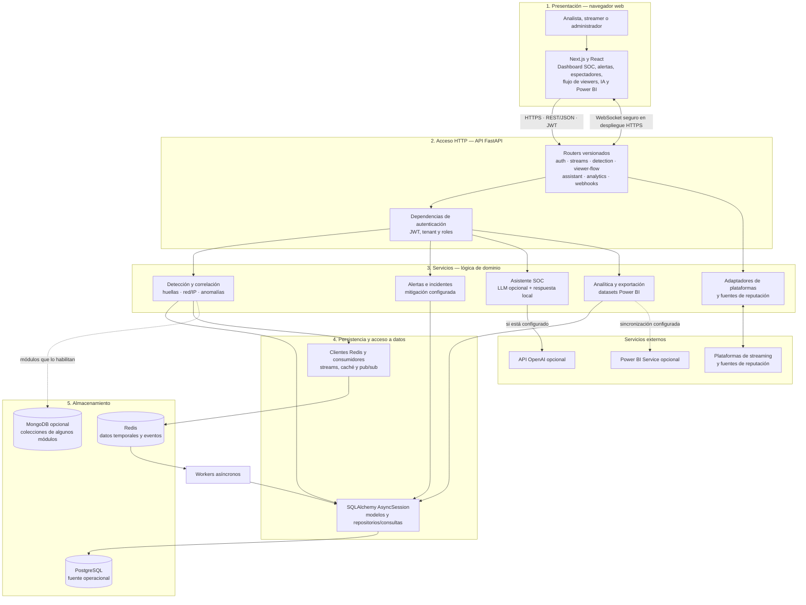
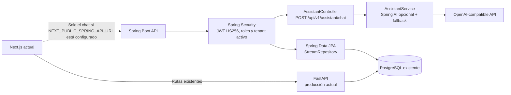
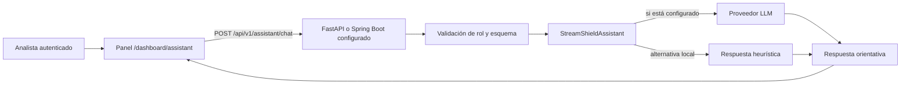
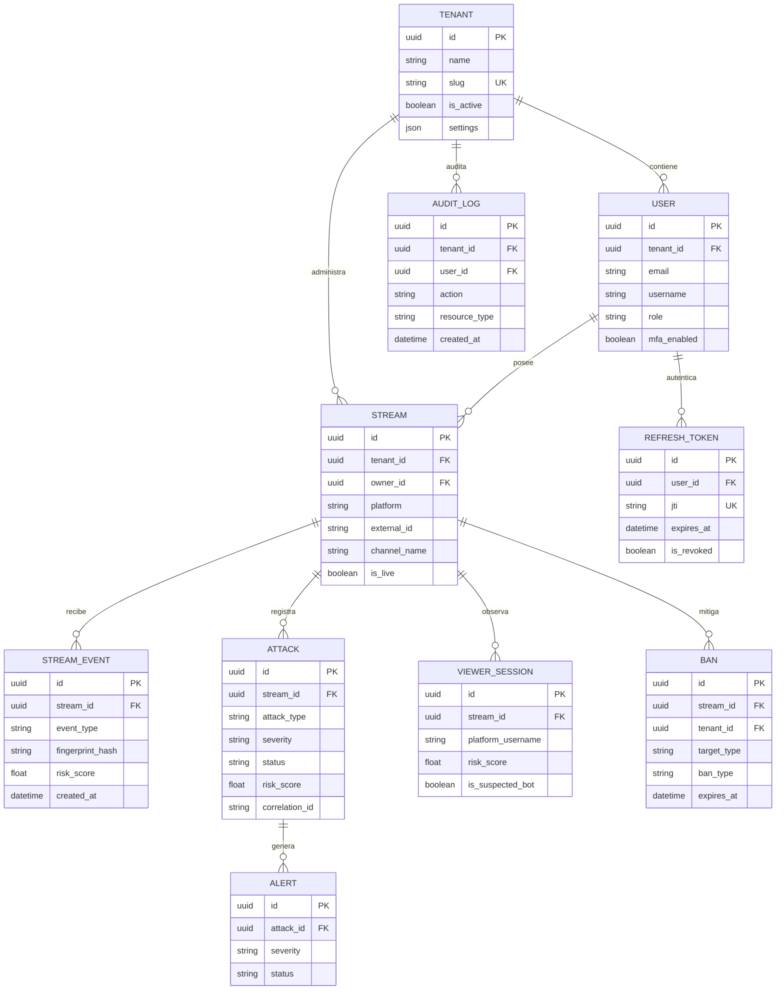
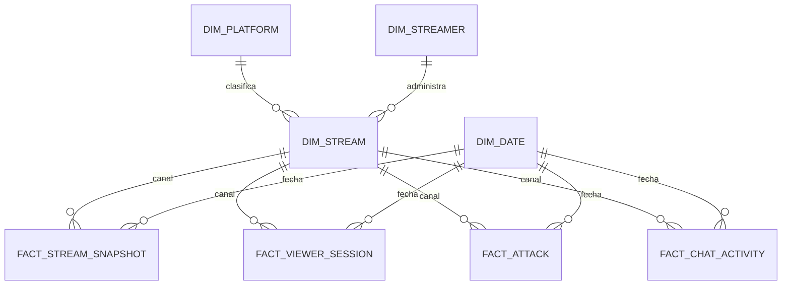

# Documentación de entregables académicos — StreamShield

**Proyecto:** StreamShield — monitoreo y análisis de amenazas en transmisiones en vivo  
**Repositorio:** [NlsG09201/Anti-Bots](https://github.com/NlsG09201/Anti-Bots)  
**Fecha de corte de la documentación:** 20 de noviembre de 2026

## Alcance y fidelidad técnica

Este documento reúne la evidencia del repositorio para los requisitos de Desarrollo Web Avanzado, Visualización de Datos II e Investigación de Operaciones. Distingue entre capacidades implementadas, prototipos respaldados por código y propuestas académicas. No presenta una tecnología como implementada si no existe evidencia en el proyecto.

La aplicación principal utiliza **Next.js/React**, **FastAPI/Python**, **PostgreSQL** y **Redis**. Se añadió un servicio complementario aislado en **Spring Boot 4.1.2**, con Spring Security, Spring Data JPA y Spring AI 2.0.2 para el agente SOC y una consulta de canales por tenant. El servicio Java no sustituye la API FastAPI ni sus demás rutas. La descripción detallada de stack, capas, endpoints, interfaz, LLM y datos está en [`DESARROLLO-WEB-AVANZADO.md`](DESARROLLO-WEB-AVANZADO.md).

## 1. Desarrollo Web Avanzado

### 1.1 Arquitectura de la aplicación

El diseño adapta las capas de presentación, controlador, servicio, acceso a datos, modelo y base de datos del esquema de referencia al sistema real. La capa de presentación está en `frontend/src/app/` y consume `frontend/src/lib/api.ts`. La API existente registra routers FastAPI versionados desde `backend/app/main.py`. El nuevo módulo Spring agrega las primeras rutas Java de forma independiente y reutiliza el formato de JWT actual. El frontend puede dirigir el chat a Spring mediante `NEXT_PUBLIC_SPRING_API_URL`; si no se configura, sigue usando FastAPI.

Los servicios operacionales de detección, correlación, alertas, mitigación y analítica siguen en `backend/app/services/`; el módulo Java está en `backend-spring/`. FastAPI conserva SQLAlchemy y `AsyncSession`; Spring Data JPA consulta las tablas compartidas `users` y `streams`, con Hibernate configurado para no alterar el esquema. PostgreSQL conserva los registros operacionales y Redis mantiene elementos temporales y flujos de eventos. Spring AI puede conectarse a OpenAI o a un proveedor compatible configurado por entorno; el fallback local sigue disponible. La API Java aún no implementa WebSocket, OAuth de plataformas, ingestión ni el conjunto de detección/mitigación.

| Capa del esquema de referencia | Adaptación concreta en StreamShield | Responsabilidad |
| --- | --- | --- |
| Presentación web | Next.js, React y componentes del dashboard | Mostrar SOC, señales, vistas y formularios; iniciar llamadas protegidas y recibir actualizaciones. |
| Controller | Routers FastAPI existentes y `AssistantController` Spring | Atender las rutas actuales y las rutas Java migradas; validar entradas y delegar. |
| Service | Servicios FastAPI existentes y `AssistantService` Java | Ejecutar lógica de dominio; el agente asesora y no aplica sanciones. |
| Repository / acceso a datos | SQLAlchemy en Python y `UserRepository` / `StreamRepository` en Spring Data JPA | Consultar los datos operacionales por tenant. Hibernate no modifica el esquema compartido. |
| Model / entidades | Modelos SQLAlchemy y entidades Java de lectura en `backend-spring/` | Mapear las tablas compartidas requeridas por cada módulo migrado. |
| Base de datos | PostgreSQL compartido; Redis para revocación opcional y flujos actuales | Mantener una sola fuente operacional mientras coexisten los servicios. |
| Integración de IA | Spring AI con proveedor compatible configurable y respuesta local | Orientar al analista sin ejecutar bloqueos ni sustituir revisión humana. |

### 1.2 Agente inteligente y LLM

El asistente existente continúa en `backend/app/services/assistant/service.py`. Su nueva implementación Java está en `backend-spring/src/main/java/com/streamshield/api/assistant/`, usa Spring AI y conserva el contrato de respuesta del endpoint FastAPI. El frontend envía el chat a Spring solo cuando `NEXT_PUBLIC_SPRING_API_URL` está configurado; de lo contrario, usa el backend actual. Spring AI se habilita con `AI_ENABLED=true` y una clave de proveedor; sin esa configuración o ante un error del proveedor, responde el fallback local. Ninguna variante ejecuta mitigaciones.

**Prototipo de clases real:** `AssistantPage` mantiene la conversación temporal en el estado del navegador y llama a `api.assistant.chat`; `chat_with_assistant` valida el usuario mediante la dependencia `AnalystUser`, acepta `AssistantChatRequest` y entrega `AssistantChatResponse`; `StreamShieldAssistant.answer` decide entre proveedor LLM y respuesta local. Los esquemas limitan el mensaje a 1.000 caracteres y el historial a seis mensajes. No se almacena una conversación en una tabla de base de datos.

### 1.3 Control de acceso y seguridad

FastAPI mantiene sus controles existentes. En las rutas Java migradas, Spring Security valida el JWT HS256 compartido, limita el acceso por rol y la capa de servicio verifica que la cuenta siga activa y corresponda al tenant del token:

| Requisito | Evidencia y comportamiento actual |
| --- | --- |
| Autenticación | FastAPI valida JWT de acceso en `backend/app/api/dependencies.py`; Spring Security usa el mismo `JWT_SECRET_KEY`, exige `type=access` y valida expiración y claims de identidad. |
| Autorización | `AnalystUser` en FastAPI y `SecurityFilterChain`/`@PreAuthorize` en Spring permiten los roles `analyst`, `admin` y `super_admin` para rutas protegidas. |
| Contraseñas y tokens | `backend/app/core/security.py` usa bcrypt para verificar contraseñas; define JWT de acceso y renovación, y cifrado Fernet para valores sensibles. |
| Sesiones y revocación | `RefreshToken` y `TokenBlacklist` están definidos en el modelo actual; FastAPI usa Redis. Spring consulta la misma clave con `SPRING_CHECK_REDIS_BLACKLIST=true` y `REDIS_URL`; en `APP_ENV=production` ambas opciones son requisito de arranque. |
| Validación de entrada | Esquemas Pydantic limitan longitud y forma del mensaje/historial del asistente. |
| Protección web | El proyecto incluye middleware y módulos de CSRF, rate limiting, cabeceras y gateway en `backend/app/infrastructure/security/`. La aplicación debe desplegarse detrás de HTTPS; WSS depende de ese despliegue. |
| Secretos | Las claves de proveedores y bases de datos se suministran por configuración/variables del entorno, no se incluyen en este documento. |

Estas referencias describen controles del código, no certifican una auditoría de seguridad ni que cada protección esté habilitada de igual manera en todos los entornos.

### 1.4 Modelo entidad-relación

El asistente no requiere tablas propias. El modelo operativo relevante está basado en las entidades declaradas en `backend/app/infrastructure/database/models.py`.

El diagrama resume relaciones y atributos de interés para el informe. Las claves, restricciones y campos completos deben consultarse en las clases del modelo; no se afirma que el diagrama sustituya el esquema de migraciones vigente.

### 1.5 Diccionario de datos resumido

| Entidad | Propósito | Campos representativos |
| --- | --- | --- |
| `tenants` | Aislar organizaciones y su configuración | `id`, `name`, `slug`, `is_active`, `settings` |
| `users` | Identidad, pertenencia y rol | `id`, `tenant_id`, `email`, `username`, `role`, `mfa_enabled` |
| `refresh_tokens` | Ciclo y revocación de sesión | `user_id`, `jti`, `expires_at`, `is_revoked` |
| `streams` | Canales supervisados | `tenant_id`, `owner_id`, `platform`, `external_id`, `channel_name`, `is_live` |
| `stream_events` | Eventos observados y señales de riesgo | `stream_id`, `event_type`, `ip_address`, `fingerprint_hash`, `risk_score`, `created_at` |
| `fingerprints` | Huellas y banderas de automatización | `hash`, indicadores headless/Selenium/Playwright, `occurrence_count`, `risk_score` |
| `ip_reputations` | Reputación y clasificación de red | `ip_address`, `asn`, `country_code`, `is_proxy`, `is_vpn`, `is_tor`, `reputation_score` |
| `attacks` | Incidentes agrupados/correlacionados | `stream_id`, `attack_type`, `severity`, `status`, `risk_score`, `evidence` |
| `alerts` | Seguimiento de notificaciones | `tenant_id`, `attack_id`, `severity`, `status` |
| `viewer_sessions` | Sesiones observadas en un canal | `stream_id`, `platform_username`, `risk_score`, `is_suspected_bot`, marcas de tiempo |
| `bans` | Registro de mitigaciones | `stream_id`, `tenant_id`, `target_type`, `ban_type`, `expires_at` |
| `audit_logs` | Trazabilidad de operaciones | `tenant_id`, `user_id`, `action`, `resource_type`, `created_at` |

**Repositorio:** [https://github.com/NlsG09201/Anti-Bots](https://github.com/NlsG09201/Anti-Bots)

## 2. Visualización de Datos II

La guía técnica y de evidencia reproducible está en [`POWERBI-ANALYTICS.md`](POWERBI-ANALYTICS.md). Describe las fuentes, el ETL, las ocho tablas del dataset tenant-scoped, las relaciones del modelo PBIP, sus visualizaciones y filtros, y los endpoints de integración web. También distingue la sincronización BigQuery del push dataset Microsoft. El informe PBIP y el código son artefactos reales del repositorio; las capturas de Power BI Desktop/Service y la verificación de publicación requieren ejecutar el flujo con las cuentas y datos autorizados del equipo.

### 2.1 Fuentes de datos y acceso

| Fuente | Tipo de dato | Acceso en el proyecto | Uso analítico |
| --- | --- | --- | --- |
| PostgreSQL | Relacional, operacional y warehouse intermedio | SQLAlchemy, modelos y esquema `bi` | Canales, sesiones, ataques, actividad de chat y hechos/dimensiones. |
| Google BigQuery | Warehouse analítico en la nube | `BigQueryWarehouseService` mediante Application Default Credentials | Dataset físico separado para cada tenant; Power BI lo consulta directamente. |
| Redis | Clave/valor y flujos | Caché y eventos del backend | Datos temporales; no es la fuente histórica del informe. |
| MongoDB y APIs de plataforma | Documentos y servicios externos opcionales | Adaptadores de integraciones configuradas | Enriquecimiento y señales disponibles según permisos y credenciales. |

`bi.refresh_warehouse` transforma datos PostgreSQL y carga las dimensiones/hechos. El proceso programado puede replicar tablas a BigQuery después de la carga; un analista también puede iniciar la carga manual desde Power BI SOC Analytics. La API aplica aislamiento por tenant y determina el dataset destino en servidor. El conector de Power BI usa credenciales Google autorizadas para ese dataset.

### 2.2 Modelo dimensional implementado

El Data Warehouse PostgreSQL está definido físicamente en `business-intelligence/sql/001_warehouse.sql`; `002_refresh_warehouse.sql` es el proceso ETL idempotente. BigQuery conserva las claves y el grano en ocho tablas por tenant:

| Tabla BigQuery | Tipo y grano |
| --- | --- |
| `dim_date` | Dimensión: una fila por fecha, con atributos calendario. |
| `dim_platform` | Dimensión: una fila por plataforma. |
| `dim_streamer` | Dimensión: una fila por streamer del tenant. |
| `dim_stream` | Dimensión: una fila por canal, plataforma y streamer. |
| `vw_powerbi_stream_snapshot` | Hecho: canal y día, viewers, chatters, engagement y amenaza. |
| `vw_powerbi_viewer_session` | Hecho: una fila por sesión de espectador. |
| `vw_powerbi_attack` | Hecho: una fila por incidente, severidad, riesgo y mitigación. |
| `vw_powerbi_chat_activity` | Hecho: canal, fecha y tipo de evento de chat. |

Las relaciones usan `stream_id`, `full_date` y `platform_key`; están representadas en el modelo TMDL del PBIP. El dataset tiene nombre `streamshield_bi_<uuid_del_tenant_sin_guiones>` y evita mezclar registros entre organizaciones.

### 2.3 Dashboard e integración con la aplicación

`business-intelligence/powerbi/StreamShield-BI.pbip` contiene el modelo, medidas y las páginas **Resumen ejecutivo** y **Amenazas y actividad**, con filtros por fecha, plataforma, canal y banda de riesgo. Sus consultas M consumen las tablas BigQuery. La aplicación permite sincronizar los datos reales con `POST /api/v1/analytics/bigquery/sync`; el cron realiza la carga programada. La actualización de Power BI Service se programa después de la ejecución del cron con las credenciales Google del tenant. La vista web integrada presenta analítica propia y no es un iframe del PBIP.

Desde Power BI SOC Analytics se descargan archivos de analítica JSON/Excel/ZIP y, cuando se configura un informe publicado, **PDF, PPTX y PBIX generados por Power BI Service**. El backend valida el tenant autorizado, oculta los secretos Microsoft y devuelve el archivo como respuesta adjunta desde `GET /api/v1/analytics/exports/powerbi-report?format=pdf|pptx|pbix`.

La guía de aprovisionamiento, permisos, parámetros del PBIP, publicación y descarga está en [`business-intelligence/README.md`](../business-intelligence/README.md). La integración y el PBIP están implementados; la conexión, publicación, refresh real y capturas requieren las cuentas del equipo en Google Cloud y Microsoft. No se incluyen resultados o capturas inventadas.
## 3. Investigación de Operaciones

El informe metodológico final que articula las tres asignaturas, declara el uso de IA y presenta limitaciones y referencias APA 7 está en [`INFORME-METODOLOGICO-FINAL.md`](INFORME-METODOLOGICO-FINAL.md).

### 3.1 Problema real derivado de StreamShield

Durante un pico de actividad, el SOC puede detectar más sesiones sospechosas de las que el equipo puede revisar inmediatamente. Revisar o mitigar primero las sesiones de mayor prioridad permite usar capacidad limitada y reducir exposición. La puntuación del sistema sirve para ordenar la revisión, pero una puntuación no demuestra por sí sola que una cuenta sea un bot. Por ello, el modelo siguiente optimiza **priorización de revisión humana**, no bloqueos automáticos.

### 3.2 Modelo de programación lineal binaria

Para cada sesión candidata real (i), definir (x_i\in\{0,1\}) (incluirla en la cola), (p_i=\operatorname{clip}(risk\_score_i/100,0,1)) (proxy de prioridad; no es probabilidad calibrada), (t) (minutos uniformes por revisión), (c\ge0) (costo relativo de falso positivo), (B) (minutos disponibles) y (F) (presupuesto de exposición, puntos 0–100). El analista introduce (t,c,B,F) en cada ejecución.

**Maximizar**

\(\displaystyle \sum_i (p_i-c(1-p_i))x_i\)

**Sujeto a**

\(\displaystyle \sum_i t x_i \le B\) (capacidad de revisión)

\(\displaystyle \sum_i c(1-p_i)x_i \le F\) (presupuesto proxy de exposición)

\(x_i\in\{0,1\}\quad\forall i\) (selección binaria)

La exposición (c(1-p_i)) no es una tasa observada de falsos positivos y el puntaje no es una probabilidad. El equipo debe acordar los parámetros de operación.

**Implementación operativa:** `backend/app/services/optimization/review_queue.py` resuelve exactamente la mochila binaria mediante programación dinámica entera. La ruta autenticada `POST /api/v1/operations-research/review-queue/optimize` consulta sesiones activas y sospechosas y sus canales, siempre filtrados por tenant. Acepta capacidad (1–1440 min), tiempo por revisión (1–120 min), presupuesto (0–100 puntos), costo relativo (0–10), canal opcional y límite de candidatas (hasta 2.000). No usa datos sintéticos, no modifica registros ni aplica bans.

La vista [`/dashboard/operations-research`](../frontend/src/app/dashboard/operations-research/page.tsx) comunica parámetros por REST/JSON con el token de sesión y muestra la respuesta calculada: candidatas reales, selección, tiempo usado, exposición proxy y orden de revisión. Sin datos factibles, informa que no hay sesiones elegibles; no sustituye la ausencia de datos con cifras de ejemplo.

**Evidencia reproducible:** iniciar backend y frontend según la configuración normal, entrar con rol analista o superior y abrir **Protection → Operations Research**. Ejecutar “Resolver con sesiones reales”. La respuesta se puede inspeccionar en Network para `POST /api/v1/operations-research/review-queue/optimize` y en la documentación OpenAPI bajo **Operations Research**. Los resultados son propios de la consulta del tenant en ese momento; la vista avisa si alcanzó el límite de candidatas. La salida recomienda revisión humana, nunca sanciones.

## 4. Matriz de cumplimiento por objetivo

El porcentaje estima el avance documental y funcional demostrable en este repositorio. No equivale a una calificación del docente ni a la aprobación de un entregable externo. Los porcentajes reflejan que hay código y/o diseño en esta entrega; los elementos expresamente pendientes requieren evidencia independiente.

| Objetivo específico | Evidencia (sección o anexo) | Avance / estado | Pendiente para 8.º |
| --- | --- | ---: | --- |
| 1. Documentar arquitectura, agente inteligente, interfaz integrada, seguridad, modelo ER/diccionario y repositorio | Secciones 1.1–1.5; módulo Spring real en `backend-spring/`, seguridad JWT compartida, consulta JPA por tenant, agente conectado opcionalmente desde el frontend y repositorio enlazado. | 75% | Migrar las rutas restantes de FastAPI con compatibilidad de contrato y pruebas antes de sustituirlo; desplegar Spring con secretos propios y verificar el chat en el entorno integrado. Anexar capturas del despliegue final. |
| 2. Identificar fuentes, tipos y acceso; definir modelo dimensional y dashboard Power BI | Secciones 2.1–2.3 y guía `POWERBI-ANALYTICS.md`; warehouse PostgreSQL, mirror tenant-scoped BigQuery, PBIP/TMDL, dashboard web y endpoints de sincronización/exportación. | Implementación en repositorio | En las cuentas del equipo: aprovisionar GCP, conectar/actualizar PBIP, publicar en Power BI Service y adjuntar capturas con datos reales. No se puede certificar la publicación o actualización cloud desde este repositorio. |
| 3. Plantear y resolver un problema real de Investigación de Operaciones | Secciones 3.1–3.2; solver exacto, endpoint por tenant y dashboard ejecutable sobre sesiones operacionales. | 100% implementación | Validar con el equipo los valores de tiempo, costo y exposición; las puntuaciones disponibles no están calibradas estadísticamente como probabilidades. |
| 4. Adjuntar evidencia y resultados analíticos respetando límite de plantilla | Sección 3.2 describe el flujo para reproducir y consultar resultados reales en la API y el dashboard. | 80% | Ejecutar en el entorno del equipo, guardar captura de la respuesta con sus datos reales y adaptar portada/extensión/anexos a la plantilla oficial. |

### Evidencia que debe completar el equipo antes de entregar

1. Sustituir esta matriz por la matriz oficial si la plantilla del curso tiene columnas o criterios distintos.
2. Incluir capturas legibles del panel/flujo del agente y del informe Power BI, sin exponer tokens, correos, IP u otros datos personales.
3. Para Investigación de Operaciones, adjuntar un conjunto de datos autorizado y resultados del solver; no reportar valores supuestos como mediciones.
4. La integración Java es aditiva y no cambia el backend que atiende producción. Completar por módulos la paridad de FastAPI antes de cualquier cambio del origen general de API; no declarar migradas las funciones que aún viven en Python.
5. Revisar el límite de páginas de la plantilla y mover diagramas/tablas/capturas a figuras o anexos cuando corresponda.

## Referencias internas del proyecto

- [`backend-spring/README.md`](../backend-spring/README.md)
- [`ENTREGABLES-AGENTE-INTELIGENTE.md`](ENTREGABLES-AGENTE-INTELIGENTE.md)
- [`POWERBI-ANALYTICS.md`](POWERBI-ANALYTICS.md)
- [`DATA-STORES.md`](DATA-STORES.md)
- [`ENTERPRISE-ARCHITECTURE.md`](ENTERPRISE-ARCHITECTURE.md)
- [`GUIA-DEL-PROYECTO.md`](GUIA-DEL-PROYECTO.md)
