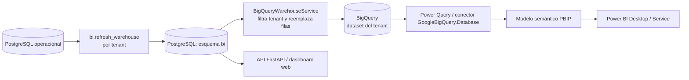

# Visualización de Datos II — StreamShield

**Entregable:** evidencias del dashboard interactivo de Power BI y su integración con StreamShield.
**Repositorio:** [NlsG09201/Anti-Bots](https://github.com/NlsG09201/Anti-Bots)

Este documento describe los artefactos y flujos implementados en el repositorio. No afirma que exista un informe publicado en la cuenta Microsoft del equipo: la publicación y las capturas de Power BI Service requieren las credenciales del equipo. No se incluyen conjuntos de datos ficticios.

## 1. Fuentes de datos

| Origen | Tipo y uso | Integración |
| --- | --- | --- |
| PostgreSQL operacional (`public`) | Relacional; canales, usuarios, sesiones de espectadores, ataques y actividad disponible | FastAPI/SQLAlchemy y el procedimiento ETL `bi.refresh_warehouse`. |
| PostgreSQL Data Warehouse (`bi`) | Modelo dimensional intermedio para analítica histórica | `business-intelligence/sql/001_warehouse.sql` define tablas, hechos, dimensiones y vistas tenant-scoped; `002_refresh_warehouse.sql` define el ETL. |
| Google BigQuery | Warehouse en nube para el modelo Power BI | `BigQueryWarehouseService` replica las tablas del tenant autenticado en un dataset separado. Usa ADC/service account en backend; no envía credenciales al navegador. |
| Redis | Datos temporales, caché y eventos operacionales | No es fuente histórica del dashboard. |
| APIs de plataformas | Señales operacionales según adaptador, autorización y permisos | Twitch, Kick, YouTube y otras plataformas configuradas; sus datos se reflejan en PostgreSQL cuando los módulos los ingieren. |

El flujo analítico parte de los datos realmente persistidos en PostgreSQL. Las filas no se crean para poblar el reporte: si el tenant no tiene registros fuente, las tablas sincronizadas pueden quedar vacías.

## 2. Data Warehouse y proceso ETL

El esquema `bi` se instala sobre la base PostgreSQL operacional después de aplicar las migraciones de la aplicación. El procedimiento `bi.refresh_warehouse(tenant_id, from_date)` actualiza dimensiones y hechos de un tenant, genera las fechas de calendario y agrega datos de sesiones, ataques, canales y actividad de chat. El refresco programado usa una ventana de 90 días por defecto y se ejecuta por tenant. La carga es idempotente mediante claves y `ON CONFLICT`.

El proceso `backend/app/services/analytics/warehouse_refresh.py` invoca ese procedimiento y, si BigQuery está habilitado y configurado, sincroniza el resultado. `backend/scripts/refresh_warehouse.py` y `business-intelligence/scripts/refresh_warehouse.py` exponen la tarea. El endpoint `POST /api/v1/analytics/bigquery/sync` permite que un analista autorizado inicie el mismo flujo desde la aplicación. El destino se deriva del `tenant_id` autenticado; el cliente no elige el tenant/dataset. El dataset usa el patrón `streamshield_bi_<uuid_sin_guiones>`.

La replicación crea o conserva ocho tablas en BigQuery: cuatro dimensiones y cuatro tablas de hechos/vistas analíticas. La escritura reemplaza las filas de la tabla del tenant para que las cargas repetidas no acumulen duplicados.

## 3. Modelo dimensional

El proyecto Power BI está en [`business-intelligence/powerbi/StreamShield-BI.pbip`](../business-intelligence/powerbi/StreamShield-BI.pbip). El esquema relacional y las cargas están en `business-intelligence/sql/`; el modelo semántico TMDL declara tablas, relaciones y medidas.

| Tabla | Tipo | Granularidad y atributos analíticos |
| --- | --- | --- |
| `dim_date` | Dimensión | Una fila por fecha; año, trimestre, mes, semana y día. |
| `dim_platform` | Dimensión | Una fila por plataforma. |
| `dim_streamer` | Dimensión | Una fila por usuario/streamer dueño de canales del tenant. |
| `dim_stream` | Dimensión | Una fila por canal; relaciona streamer y plataforma. |
| `fact_stream_snapshot` / `vw_powerbi_stream_snapshot` | Hecho | Canal y fecha; viewers, chatters, espectadores sospechosos, ataques activos, engagement y riesgo. |
| `fact_viewer_session` / `vw_powerbi_viewer_session` | Hecho | Una fila por sesión; actividad, duración, mensajes y score de riesgo. |
| `fact_attack` / `vw_powerbi_attack` | Hecho | Una fila por incidente; tipo, severidad, estado, riesgo y mitigación. |
| `fact_chat_activity` / `vw_powerbi_chat_activity` | Hecho | Canal, fecha y tipo de evento; mensajes, usuarios y mensajes sospechosos. |

Las relaciones del modelo están declaradas en [`relationships.tmdl`](../business-intelligence/powerbi/StreamShield-BI.SemanticModel/definition/relationships.tmdl): cada hecho se relaciona con `dim_stream` por `stream_id`; las fechas de los hechos se relacionan con `dim_date[full_date]`; canal se relaciona con plataforma y streamer mediante sus claves. El dataset se segmenta por tenant antes de llegar a Power BI.

## 4. Dashboard interactivo

El PBIP contiene dos páginas definidas en `business-intelligence/powerbi/StreamShield-BI.Report/definition/pages/`:

| Página | Indicadores y visualizaciones | Interacción implementada |
| --- | --- | --- |
| **Resumen ejecutivo** | Tarjetas de streams en vivo, viewers, chatters y ataques activos; tendencias de chat; ataques por severidad. | Segmentadores de plataforma y banda de riesgo; selección de filtros para analizar los datos del modelo. |
| **Amenazas y actividad** | Gráfica de severidad, evolución del riesgo y tabla de detalle de ataques. | Segmentadores de fecha y canal; interacción de los visuales con los datos filtrados. |

Las medidas DAX están en [`measures.dax`](../business-intelligence/powerbi/measures.dax) y en el modelo semántico. Incluyen viewers monitoreados/sospechosos, porcentaje sospechoso, ataques activos/críticos, streams y viewers en vivo, chatters, mensajes, riesgo promedio y duración de sesión. El modelo PBIP y los archivos TMDL/JSON son los artefactos fuente del informe; no equivalen a un PBIX binario ya publicado.

Para abrir y actualizar el reporte, Power BI Desktop debe tener disponible el conector de Google BigQuery. Se configuran los parámetros de proyecto de facturación, proyecto y dataset de tenant; luego se autentica con la identidad Google autorizada y se actualizan las consultas. La actualización exitosa requiere que el ETL haya cargado datos y que la identidad tenga permisos de lectura en ese dataset y permiso de jobs en el proyecto de facturación.

## 5. Integración con la aplicación web

La ruta web [`frontend/src/app/dashboard/power-bi/page.tsx`](../frontend/src/app/dashboard/power-bi/page.tsx) muestra `SocDashboard`. No es un iframe del informe publicado: es un módulo analítico de la aplicación que consulta endpoints FastAPI con la sesión del usuario. Presenta tarjetas, series de viewers/amenazas, actividad de chat, ataques, predicciones y tabla de datasets/exportaciones. Sus filtros de ventana temporal son 24 h, 7 días y 30 días.

La interfaz conserva además una sincronización de **Power BI Push Dataset** en `POST /api/v1/analytics/powerbi/sync`. Ese flujo usa credenciales Microsoft (`POWERBI_*`) y es distinto del mirror dimensional tenant-scoped a BigQuery (`POST /api/v1/analytics/bigquery/sync`) que consume el PBIP. El botón “Sync Power BI” corresponde al push dataset; “Sync BigQuery” refresca el warehouse dimensional. No se deben interpretar como la misma carga.

Las rutas usadas incluyen:

- `GET /api/v1/analytics/overview` y endpoints de métricas de streams, amenazas, actividad y metadatos.
- `GET /api/v1/analytics/bigquery/config` para mostrar el proyecto/dataset que corresponde al tenant autenticado.
- `POST /api/v1/analytics/bigquery/sync` para recalcular el warehouse del tenant y sincronizarlo a BigQuery.
- `GET /api/v1/analytics/exports/json`, `/csv`, `/excel` y `/powerbi-package` para exportar datos analíticos generados por la aplicación.
- `GET /api/v1/analytics/exports/powerbi-report?format=pdf|pptx|pbix` para solicitar una exportación del informe publicado en Power BI Service.

La exportación PDF/PPTX/PBIX requiere `POWERBI_ENABLED`, credenciales del service principal y un informe existente/configurado en el workspace. No publica automáticamente el PBIP. Los botones de exportación muestran error de configuración si falta esa dependencia; la sincronización BigQuery requiere `BIGQUERY_ENABLED`, `GOOGLE_CLOUD_PROJECT_ID` y credenciales Google del backend.

## 6. Configuración y reproducción con datos reales

Las instrucciones detalladas para Google Cloud, Terraform, permisos IAM, parámetros del PBIP, publicación y refresh están en [`business-intelligence/README.md`](../business-intelligence/README.md). Secuencia operativa:

1. Configurar proyecto Google Cloud y habilitar BigQuery; aplicar la infraestructura `business-intelligence/terraform-gcp` con la cuenta autorizada del equipo.
2. Configurar en el backend `BIGQUERY_ENABLED=true`, `GOOGLE_CLOUD_PROJECT_ID`, `BIGQUERY_LOCATION` y credenciales ADC/service account. No incluir claves en Git.
3. Aplicar `business-intelligence/sql/001_warehouse.sql` y `002_refresh_warehouse.sql` en la base PostgreSQL operacional y verificar que el ETL/cron del despliegue use `backend/scripts/refresh_warehouse.py`.
4. Iniciar sesión como analista, ejecutar **Sync BigQuery** en el dashboard web o llamar el endpoint, y comprobar dataset y conteos de tablas en BigQuery.
5. Abrir el PBIP en Power BI Desktop, configurar sus parámetros/credenciales, actualizar el modelo y verificar visuales y filtros con datos del tenant autorizado.
6. Para publicar, usar el workspace Power BI del equipo, configurar credenciales de origen y refresh después de la carga. Solo entonces configurar la exportación desde la aplicación con un `POWERBI_REPORT_ID` real.

No se versionan credenciales ni datos de clientes. Los archivos `.env.example` enumeran variables sin proporcionar secretos válidos.

## 7. Evidencias entregables

El repositorio contiene el archivo PBIP, el modelo semántico, las páginas/visuales, las consultas Power Query, las medidas DAX, el SQL del warehouse, el proceso ETL, endpoints de sincronización y la vista web integrada. Estos archivos permiten revisar la implementación y reproducirla con acceso a los servicios del equipo.

No se encontraron capturas de Power BI Desktop/Service ni un PBIX publicado en el repositorio. Por ello, las capturas de ejecución y la evidencia de actualización con datos reales se deben guardar después de ejecutar los pasos de la sección 6 en las cuentas autorizadas del equipo. Las imágenes deben mostrar los filtros y visuales sin exponer datos personales ni credenciales. No se agregan imágenes de muestra como si fueran ejecuciones reales.

## Referencias de implementación

- [PBIP y modelo Power BI](../business-intelligence/powerbi/StreamShield-BI.pbip)
- [Warehouse y ETL](../business-intelligence/sql/001_warehouse.sql)
- [Guía de configuración cloud y publicación](../business-intelligence/README.md)
- [Dashboard web integrado](../frontend/src/components/power-bi/SocDashboard.tsx)
- [API de analítica](../backend/app/api/v1/powerbi_analytics.py)
